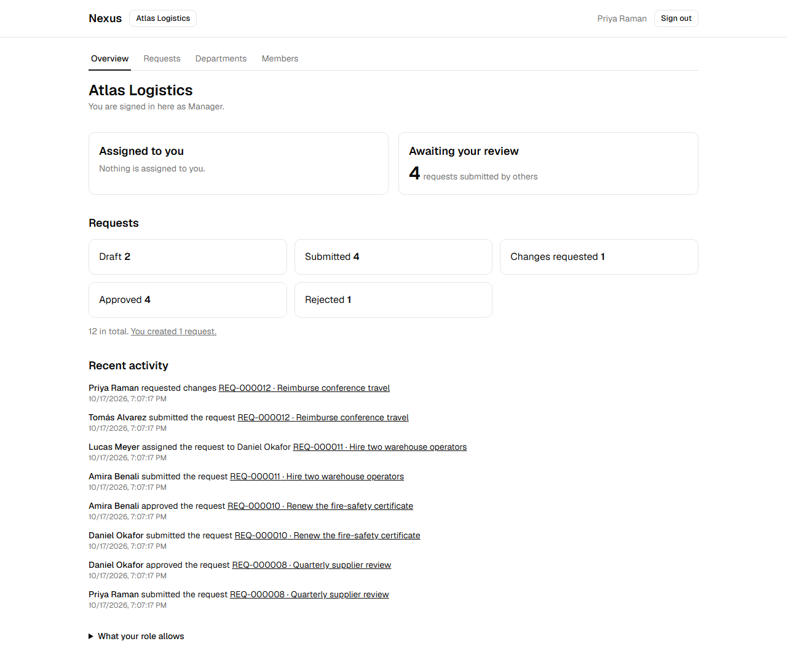
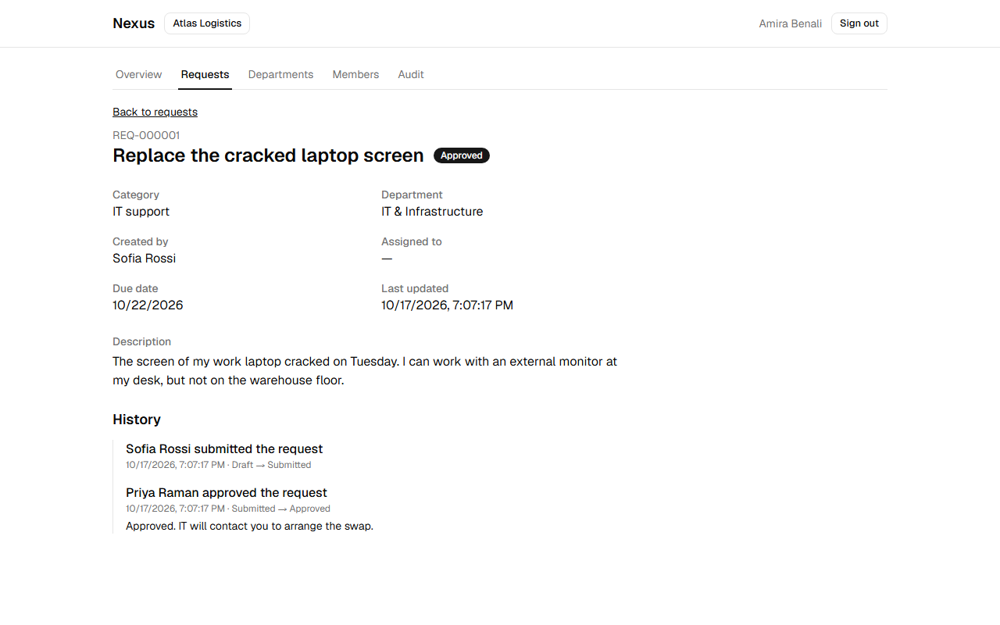
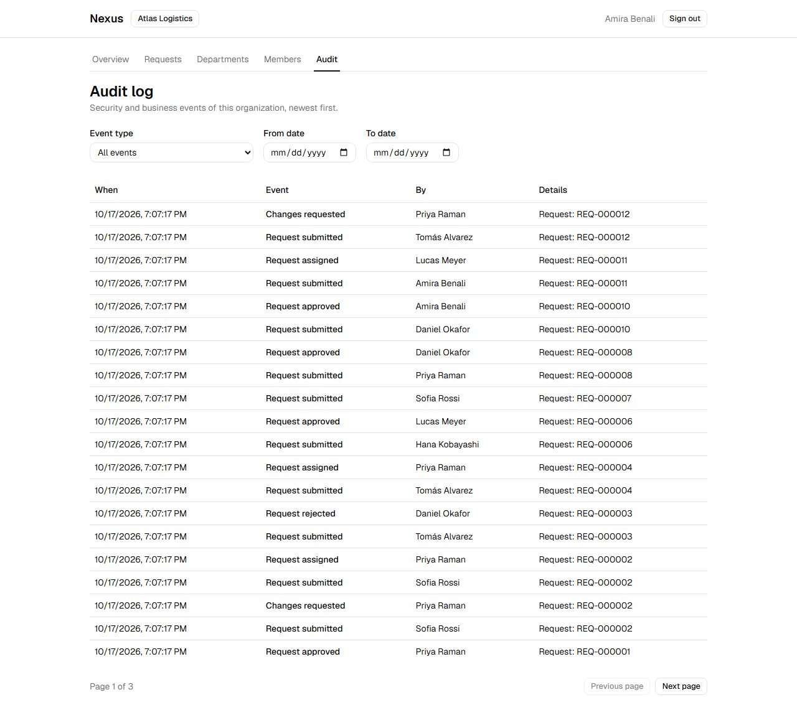
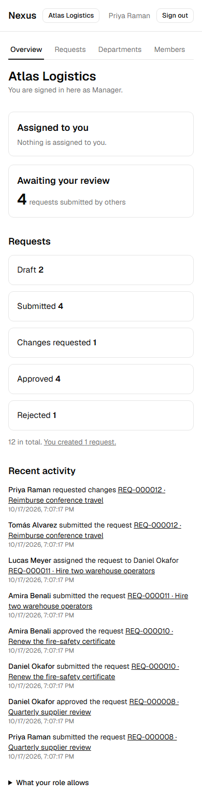

# Nexus

A multi-tenant business operations platform. Organizations manage their people, departments and internal service requests through a reviewed approval workflow, with strict tenant isolation, a complete audit trail, and a platform layer that can suspend an organization but never sees what is inside it.

> **Status: complete MVP (phases 0 to 9).** Everything described here is built, tested and documented. See [docs/status.md](docs/status.md) for what is proven and what is deliberately left out.

| | |
|---|---|
|  |  |
|  |  |

More in [docs/screenshots](docs/screenshots).

## What it does

- **Accounts:** registration with email verification, sign-in and sign-out, server-side sessions with CSRF protection.
- **Organizations:** create several, switch between them, invite people by email, four roles (Owner, Admin, Manager, Employee), role changes and removal with last-owner protection.
- **Departments:** create, search, deactivate, assign members.
- **Service requests:** reference numbers per organization (`REQ-000042`), drafts, editing by the creator, filters, search and pagination. Employees see only their own requests; reviewers see the organization's.
- **Approval workflow:** submit, approve, reject or request changes (comments required where they matter), assignment to a reviewer, a full history per request, nobody reviews their own request, and safe handling of two reviewers acting at once.
- **Audit log:** who did what, filterable, for Owners and Admins, with no personal data or review comments in it.
- **Dashboard:** requests by status, what awaits your review, what is assigned to you, recent activity; every number agrees with the list behind it.
- **Platform administration:** operators declared in configuration can suspend and reactivate an organization, with audited reasons, and see organization metadata only.
- **Operations:** security headers, size limits, safe logging, graceful behavior during outages, production container images, and a one-command demo.

## Try it

You need Docker and Node 20 or newer.

```powershell
function dc { docker compose --env-file .env.demo -f compose.prod.yaml -f compose.demo.yaml @args }
Copy-Item .env.demo.example .env.demo
dc up -d --build --wait          # builds the images and starts the stack (first build takes a few minutes)
node scripts/seed-demo.mjs       # creates two organizations, nine people and twelve requests
dc restart backend               # applies the platform operator role
```

(On Linux or macOS: `alias dc='docker compose --env-file .env.demo -f compose.prod.yaml -f compose.demo.yaml'` and `cp .env.demo.example .env.demo`.)

Open **http://localhost:8088** and sign in with the demo password `Demo-passphrase-2026`:

| Person | Role in Atlas Logistics |
|---|---|
| `amira.benali@demo.example` | Owner (also Manager in Northwind Studio) |
| `daniel.okafor@demo.example` | Admin |
| `priya.raman@demo.example`, `lucas.meyer@demo.example` | Manager |
| `sofia.rossi@demo.example`, `tomas.alvarez@demo.example`, `hana.kobayashi@demo.example` | Employee |
| `nora.lindqvist@demo.example` | Owner of Northwind Studio |
| `platform@demo.example` | Platform operator (open the Platform link) |

Emails (verification links, invitations) appear in the demo mail viewer at **http://localhost:8026**. A guided tour is in [docs/demo.md](docs/demo.md). The demo runs on plain HTTP with a shared password: it is **not** a deployment.

## Develop

```powershell
Copy-Item .env.example .env       # development settings (git-ignored)
docker compose up -d              # PostgreSQL and Mailpit for development

cd backend
.\mvnw.cmd spring-boot:run "-Dspring-boot.run.profiles=local"   # http://localhost:8080

cd ..\frontend
npm install
npm run dev                       # http://localhost:5173, proxies /api to the backend
```

Development mail is caught by Mailpit at http://localhost:8025.

| Task | Command |
|---|---|
| Backend tests, architecture rules and formatting check (needs Docker) | `cd backend; .\mvnw.cmd verify` |
| Format backend code | `.\mvnw.cmd spotless:apply` |
| Frontend checks | `cd frontend; npm run format; npm run typecheck; npm run lint; npm run test; npm run build` |
| End-to-end and accessibility tests (needs the seeded demo running) | `cd e2e; npm install; npx playwright install chromium; npx playwright test` |
| Smoke test of the running demo | `bash scripts/smoke.sh` |
| Regenerate the screenshots | `cd e2e; npm run capture` |
| Check the documentation | `node scripts/check-docs.mjs` |

A real deployment is described in [docs/deployment.md](docs/deployment.md).

## How it is built

- **Backend:** Java 21 and Spring Boot 4 (see `backend/pom.xml` for the exact version), PostgreSQL 17 with Flyway migrations, Spring Security with server-side sessions, a modular monolith whose boundaries are enforced by architecture tests.
- **Frontend:** React and TypeScript with Vite, Tailwind CSS and shadcn/ui, TanStack Query, React Hook Form and Zod.
- **Tenant isolation in layers:** the organization is in the URL and the gate checks membership; repositories are scoped by organization; composite foreign keys make the database itself refuse cross-tenant references; other tenants' data answers `404`, never `403`.
- **Quality gates in CI:** tests against real PostgreSQL, architecture rules, a dependency vulnerability scan, a build of the deployable stack with a smoke test and browser tests including an accessibility scan, and a documentation check.

```
nexus/
├── backend/             Spring Boot application, Flyway migrations, tests
│   └── src/main/java/com/l2c/nexus/
│       shared, identity, audit, organization, membership, team,
│       department, request, dashboard, platform
├── frontend/            React SPA, nginx configuration, Dockerfile
├── e2e/                 Playwright end-to-end and accessibility tests, screenshot capture
├── scripts/             smoke test, demo seed, documentation check
├── docs/                architecture, security, data model, guides, decision records
├── compose.yaml         development services (PostgreSQL, Mailpit)
├── compose.prod.yaml    the deployable stack
├── compose.demo.yaml    demo additions (a mail viewer)
└── .github/workflows/   CI, security scan, deployment check, docs check
```

## Documentation

| Document | Contents |
|---|---|
| [docs/architecture.md](docs/architecture.md) | Modules, request pipeline, tenant isolation, data, errors, frontend, deployment |
| [docs/security.md](docs/security.md) | Threat model, what is built, known limitations |
| [docs/data-model.md](docs/data-model.md) | Tables, constraints, indexes |
| [docs/api-routes.md](docs/api-routes.md) | Every route and who may call it (generated from the code) |
| [docs/deployment.md](docs/deployment.md) | Running it for real, backups, updates |
| [docs/demo.md](docs/demo.md) | The seeded demo and a guided tour |
| [docs/testing.md](docs/testing.md) | The test layers and how to run them |
| [docs/status.md](docs/status.md) | What is done, how it is proven, what remains |
| [docs/decisions](docs/decisions/README.md) | 36 architecture decision records |

## Known limitations

Account recovery (password reset, email change, multi-factor authentication) is not built; requests cannot be withdrawn or cancelled; rate limits live in memory so only one instance is supported; backups, image scanning and log aggregation are left to the operator; accessibility has automated checks but no screen-reader or user testing. The full list is in [docs/status.md](docs/status.md) and [docs/security.md](docs/security.md). Nothing here has had an external security review.

## Roadmap

| Phase | Scope | Status |
|---|---|---|
| 0 | Requirements and architecture decisions | Done |
| 1 | Foundation: skeleton, CI, local environment | Done |
| 2 | Identity and authentication | Done |
| 3 | Organizations and tenant isolation | Done |
| 4 | Memberships, invitations, roles | Done |
| 5 | Departments and service requests | Done |
| 6 | Approval workflow and audit history | Done |
| 7 | Dashboard, assignment, accessibility | Done |
| 8 | Security hardening, platform administration, failure behavior | Done |
| 9 | Deployment, demonstration, end-to-end tests, documentation | Done |

## License

MIT, see [LICENSE](LICENSE).
