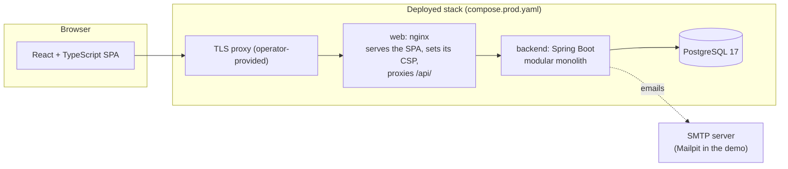
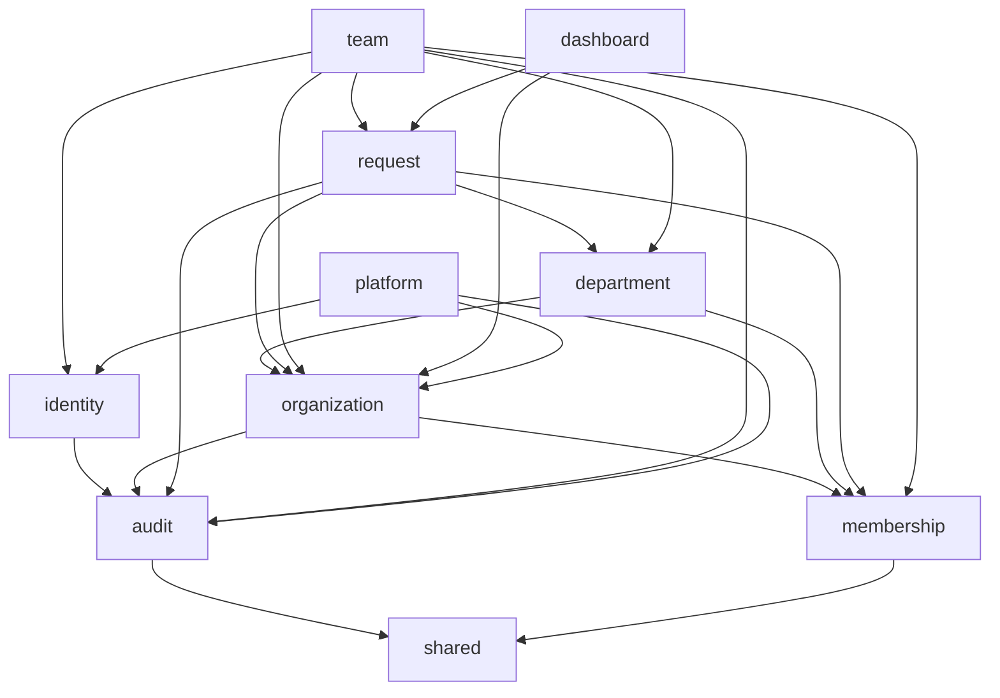

# Architecture

Nexus is a multi-tenant business operations platform built as a **modular monolith**: one Spring Boot application with strict internal boundaries, a React single-page app, and PostgreSQL. This document describes what is built. The reasons behind each choice are in the [decision records](decisions/README.md).

## System overview

The browser only ever talks to one origin. The backend and the database publish no ports; the database sits on an internal network that only the backend shares ([ADR-0034](decisions/0034-deployment.md)).

## Backend modules

| Module | Responsibility |
|---|---|
| `shared` | Time, ids, tokens, rate limiting, error types, request-size limit, failure classification, logging helpers. Depends on no feature. |
| `identity` | Registration (enumeration-safe), email verification, sessions, sign-in, account checks on every request, platform-role registry. |
| `audit` | The append-only audit log and its event vocabulary (allow-listed metadata per event type). |
| `membership` | A user's role in one organization; the membership lifecycle. |
| `organization` | Organizations, the tenant gate (`/api/orgs/{orgId}/**`), the permission matrix and access policy, request-number allocation, the platform's organization catalog and status changes. |
| `team` | Invitations, member administration, and the organization audit viewer. |
| `department` | Departments and their members. |
| `request` | Service requests, the approval workflow, assignment, history, and request statistics. |
| `dashboard` | The per-member dashboard, built on `request` statistics. |
| `platform` | Platform administration: the platform gate, organization suspension, the platform audit view, the administrator list synchronizer. |

Every module may also use `shared`. These dependencies are **enforced by an architecture test** that fails the build on any other: no cycles, application code never depends on the web layer, domain code depends on no other layer, controllers never touch entities or repositories, persistence classes and entities are private to their module, and only the platform module may change an organization's status ([ADR-0032](decisions/0032-security-hardening-and-platform-administration.md)).

Inside a module the layers are `api` (controllers, request and response types), `application` (services and use cases), `domain` (entities and rules), `persistence` (repositories and read models), plus `security` and `web` where a module owns filters. Modules reach each other only through public application services. Documented exception: a few read models (the member lists, request list, detail and history, the audit viewers, the organization catalog) join other modules' tables read-only, because sorting and displaying names needs it; writes always go through the owning module.

## What happens to a request

In order, for a call to `/api/...`:

| Step | Component | Purpose |
|---|---|---|
| 1 | Server-side session (Spring Session JDBC) | Loads the session from the cookie |
| 2 | Security headers | CSP, referrer policy, permissions policy, cross-origin policies, no caching |
| 3 | Failure filter | Turns failures outside controllers (a database outage, session loading) into safe Problem Details with `503` or `500` |
| 4 | Request size limit | `413` for bodies over 100 KB before anything else happens |
| 5 | Auth rate limit | Throttles registration, sign-in and verification per address |
| 6 | CSRF | Cookie-to-header token check on every state-changing call |
| 7 | Sign-in and sign-out | Spring Security's form login and logout, answered with status codes only |
| 8 | Active-account check | Re-reads the account on every authenticated request (disabled or unverified accounts lose the session at once) |
| 9 | Authorization | `/api/**` requires authentication except registration, verification and ping |
| 10 | Tenant gate | `/api/orgs/{orgId}/**`: the caller must hold an active membership, otherwise `404`; a suspended organization answers `403 ORGANIZATION_SUSPENDED` |
| 11 | Platform gate | `/api/platform/**`: the caller must hold the platform role right now, otherwise `404` |
| 12 | Controller | Validates input, calls one application service |
| 13 | Service | Checks the permission (`AccessPolicy`), takes locks where needed, applies the rule, writes data and audit in one transaction |

## Tenant isolation

Defense in depth, each layer tested ([security.md](security.md)):

1. The organization is in the URL path, and the gate proves membership before any controller runs.
2. Services re-read the caller's role under a lock for actions that depend on it (decisions, assignment, member changes).
3. Repositories are scoped by organization (`findByIdAndOrganizationId`); an id from another tenant is "not found". An architecture rule forbids using tenant repositories by id alone.
4. Composite foreign keys `(organization_id, id)` make the database refuse any cross-tenant reference, even from raw SQL.
5. Non-members and members lacking visibility get `404` (never `403`), so nothing reveals what exists ([ADR-0005](decisions/0005-resource-disclosure-policy.md)).

## Data

PostgreSQL 17, schema owned by Flyway (migrations V1 to V12, forward-only). Hibernate validates the schema and never changes it. See [data-model.md](data-model.md) for tables, constraints and indexes.

- **Concurrency.** Optimistic locking (`@Version`) on mutable entities; one fixed lock order, **organization row first**, then the request or department row. The organization is locked exclusively for membership changes, department assignments, request-number allocation and status changes, and in shared mode for review decisions and request assignment (many run in parallel, but a role change or removal waits for them). Atomic conditional updates protect single-use tokens and invitations.
- **Audit.** Significant events are recorded in the business transaction, append-only at the database level, with allow-listed metadata only.
- **History.** Each request's transitions and assignments are an append-only table with composite foreign keys to the request and the people involved.

## Errors and failure behavior

All errors are RFC 9457 Problem Details. Validation errors carry per-field messages; business conflicts carry a stable `code`. Unexpected failures return a generic body with an incident reference that also appears in the log line. A database outage is `503` with `Retry-After`, never `401`. Logs never contain personal data ([ADR-0033](decisions/0033-logging-and-failure-behavior.md)). Readiness depends on the database; liveness does not. Emails are sent asynchronously after commit and are best-effort.

## Frontend

React 19 with TypeScript, Vite, Tailwind CSS and shadcn/ui on Base UI primitives; TanStack Query for server state; React Hook Form with Zod for forms; React Router.

- **Structure.** `src/app` (layout, routes, page titles), `src/features/<name>` for auth, organizations, members, departments, requests, audit, dashboard and platform, `src/shared` (API client, helpers, shared components), `src/components/ui`.
- **One API client** adds the CSRF header, turns Problem Details into typed errors, and every response is validated with Zod before use.
- **Permissions and the server's hints.** Screens show controls from the member's permissions and from fields the server computes for the current viewer (`editable`, `actions`, `assignable`). These are usability hints; the server authorizes every action again.
- **Safe rendering.** User text is rendered only as text; there is no raw HTML rendering.
- **Conflicts.** Edits and actions send the version the page loaded; on a conflict the data reloads and the explanation is shown by the page, so it survives the panel that triggered it.
- **Outages.** A failed refresh of the current user never replaces the page; a `503` is described as a temporary outage.
- **Accessibility.** Page titles per route, focus moved to the main content after navigation, a skip link, labelled keyboard-focusable scroll regions for tables, wrapping navigation on narrow screens ([ADR-0031](decisions/0031-request-assignment-and-accessibility.md), [ADR-0036](decisions/0036-end-to-end-and-accessibility-testing.md)).

## Deployment

See [deployment.md](deployment.md) and [ADR-0034](decisions/0034-deployment.md): three images (database, backend, web), non-root and read-only, one public origin, secure cookies by default, internals unreachable. [demo.md](demo.md) describes the seeded demonstration.

## Quality gates

| Workflow | What it checks |
|---|---|
| CI | Backend `verify` (unit, integration against real PostgreSQL, architecture rules, formatting) and frontend format, types, lint, tests, build |
| Security scan | Known vulnerabilities in Maven and npm dependencies, on every push and weekly |
| Deployment check | Builds the images from scratch, starts the stack, smoke test, then end-to-end and accessibility tests |
| Docs check | Links, the decision index and ADR numbering |

Details of each layer are in [testing.md](testing.md).

## Decisions

All architecture decisions are recorded as ADRs: [index](decisions/README.md) (0001 to 0036).
